<p align="center">
  <picture>
    <source media="(prefers-color-scheme: dark)" srcset="./src/assets/logo-dark.png" width="380">
    
  </picture>
</p>

<p align="center">
  A calm, local-first vocabulary learning platform for Desktop and Android, engineered with spaced repetition, contextual sentence translation, and cognitive ergonomics.
</p>

<p align="center">
  <a href="https://github.com/bedwen/learnwords"></a>
  <a href="https://www.typescriptlang.org/"></a>
  <a href="https://react.dev/"></a>
  <a href="https://expressjs.com/"></a>
  <a href="https://www.sqlite.org/"></a>
  <a href="https://capacitorjs.com/"></a>
  <a href="https://vitest.dev/"></a>
  <a href="./LICENSE"></a>
</p>

<p align="center">
  <a href="#website--desktop-application">Website &amp; Desktop App</a> &nbsp;&bull;&nbsp;
  <a href="#android-mobile-application">Android Mobile App</a> &nbsp;&bull;&nbsp;
  <a href="#core-features">Core Features</a> &nbsp;&bull;&nbsp;
  <a href="#technology-stack">Technology Stack</a> &nbsp;&bull;&nbsp;
  <a href="#getting-started">Getting Started</a>
</p>

---

## Website & Desktop Application

LearnWords provides a focused, distraction-free study environment tailored for long-term vocabulary acquisition. Operating completely locally with zero external telemetry or cloud dependencies, all persistent data is stored in SQLite using Write-Ahead Logging (WAL) for instant reads and crash resilience.

The user interface is built on two harmonized color palettes: **Warm Vellum** (`#F9F7F2`) for natural, glare-free daytime reading and **Nocturnal Slate** (`#141716`) for comfortable night sessions.

### Home Dashboard
The central dashboard provides daily review queues, a 90-day study consistency heatmap, a unified statistical summary ribbon, and a CEFR proficiency breakdown.

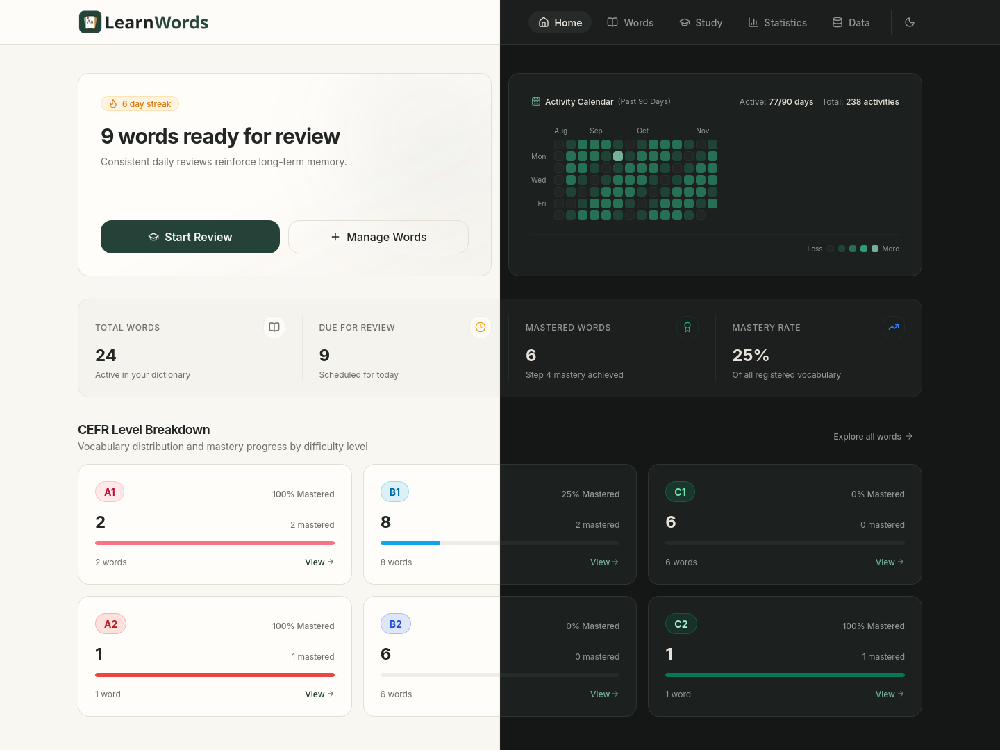

### Spaced Repetition Flashcards
Interactive 3D flashcards with tactile card stack depth, keyboard navigation, and immediate interval feedback.

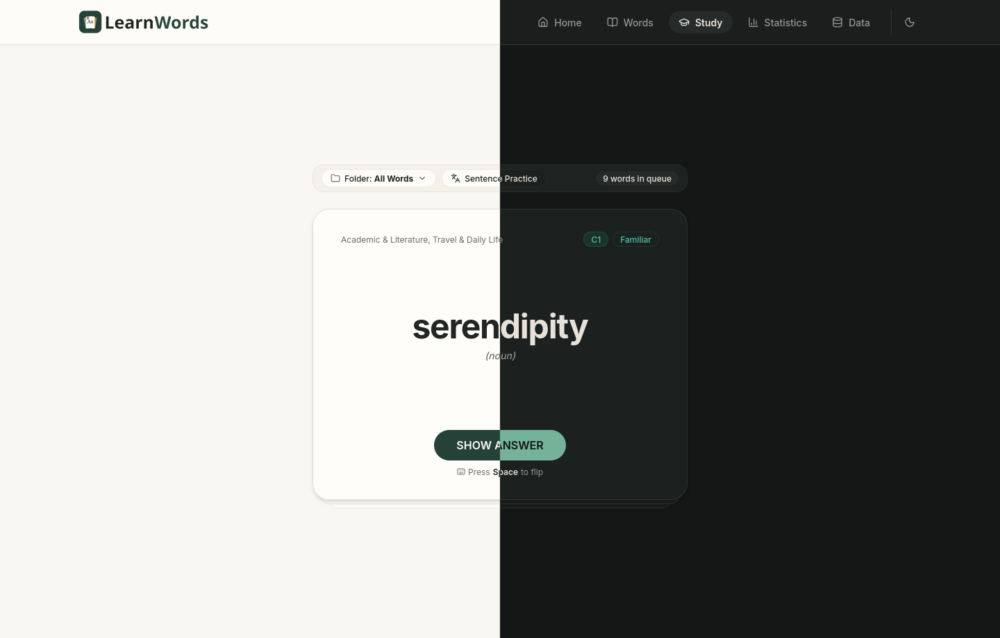

### Vocabulary Folders & Table Management
Organize vocabulary across colored thematic folders, filter by CEFR level or mastery status, and manage collections with bulk actions.

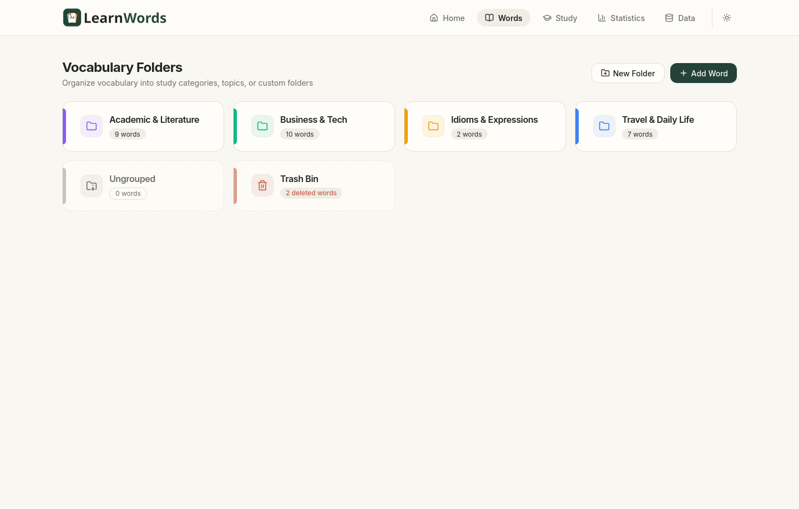

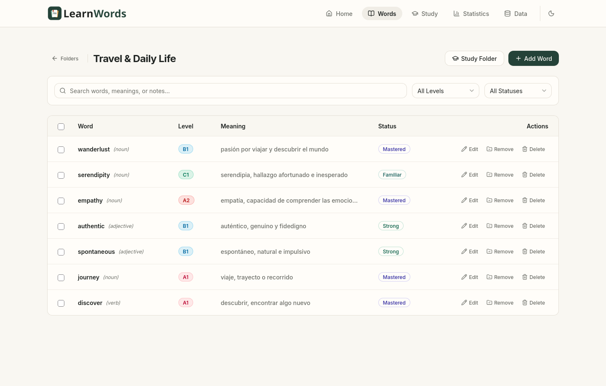

### Intuitive Creation Modals
Streamlined dialogs for organizing custom study collections and inputting vocabulary with contextual example sentences.

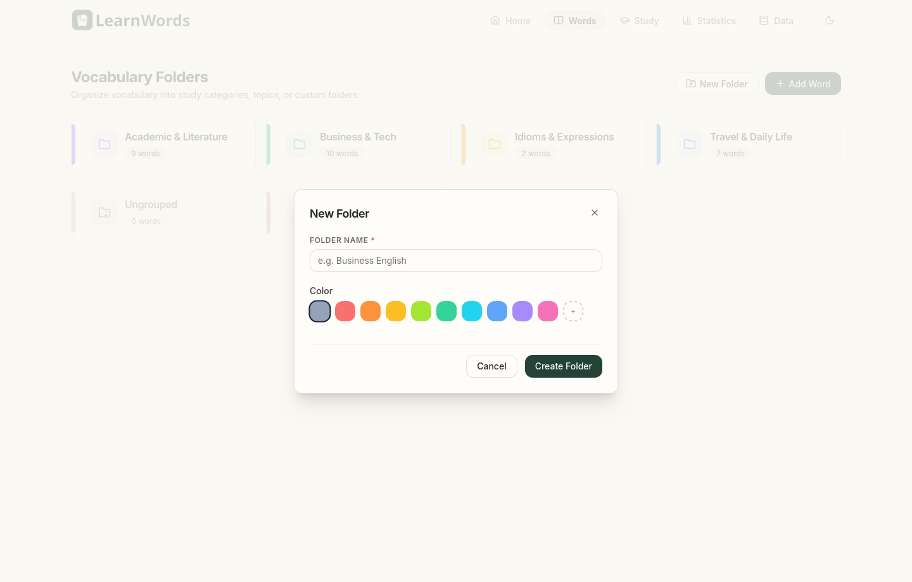

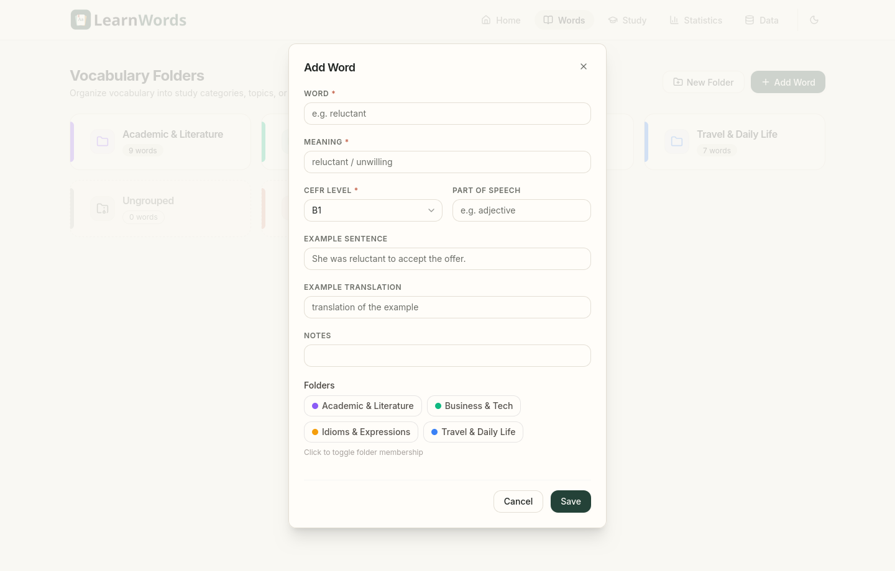

### Learning Statistics
Longitudinal analytics tracking review accuracy, difficulty distribution, and study persistence across a 90-day window.

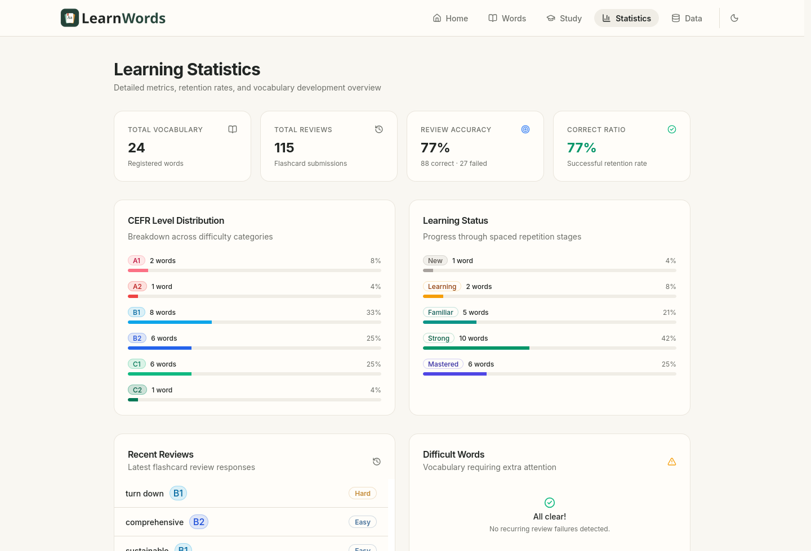

### Data Management & Synchronization
Import and export vocabulary in standard CSV format, download atomic JSON database snapshots, or synchronize progress across devices.

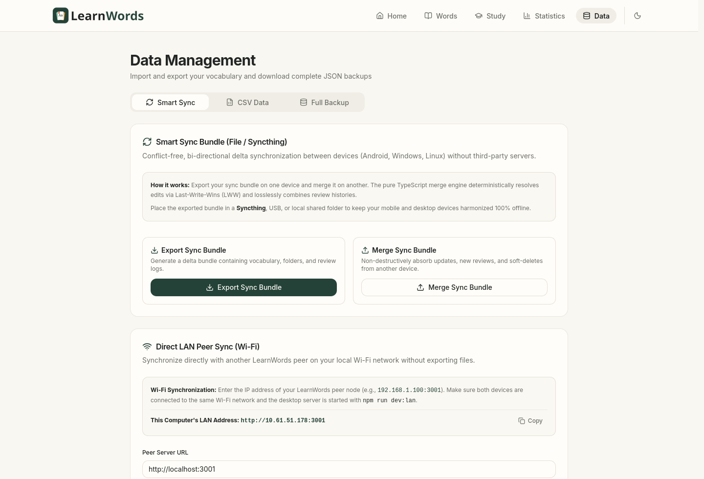

---

## Android Mobile Application

LearnWords is available as a standalone, offline-first Android application powered by Capacitor 8. Designed specifically for thumb navigation on the go, it features a locked `100dvh` viewport, a bottom navigation bar, tactile card gestures, and local IndexedDB persistence that operates seamlessly without network connectivity.

### Mobile Showcase

| Home & Activity | 3D Flashcards (Light/Dark) | Sentence Practice | Mobile Word Cards |
| :---: | :---: | :---: | :---: |
| 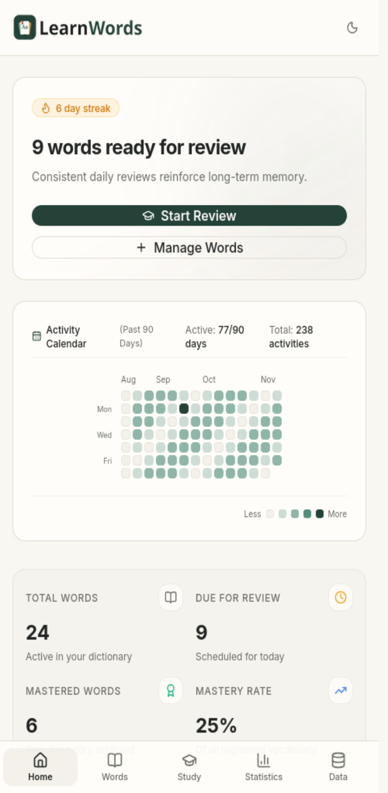 | 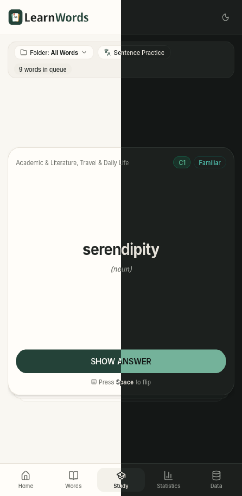 | 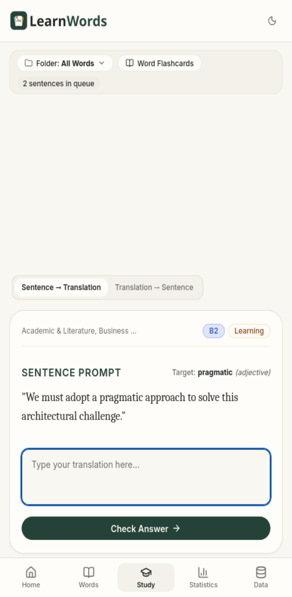 | 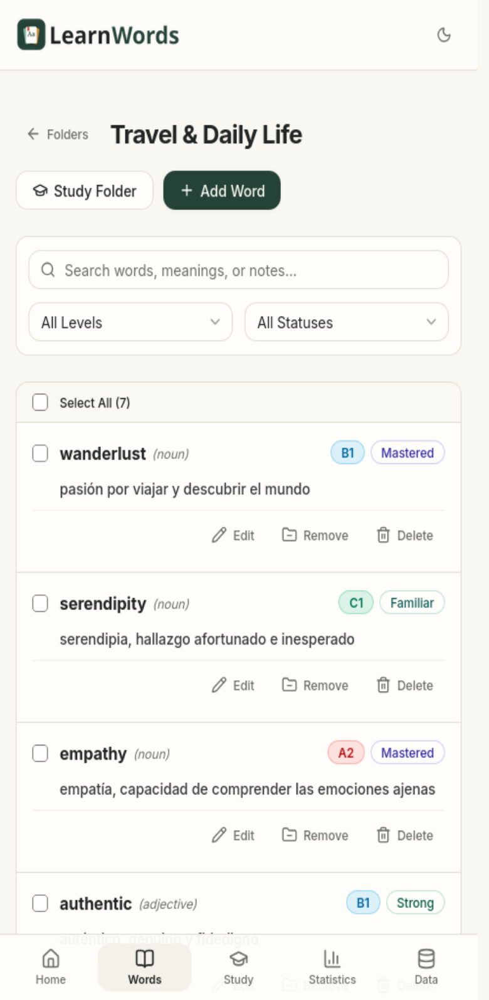 |

### Installing the Android APK (GitHub Releases)

Pre-built Android release packages are provided directly on GitHub:

1. Open the [Releases](https://github.com/bedwen/learnwords/releases) page on your Android phone or browser.
2. Download the latest release asset: `LearnWords-v1.0-release.apk`.
3. Open the downloaded file on your Android device. If prompted, permit your browser or file manager to *Install unknown apps* for this source.
4. Tap **Install** to complete the setup. Once installed, LearnWords runs completely standalone and offline.

### Building the APK Locally

To compile and package the Android APK on your development machine:

```bash
# Build the mobile frontend bundle and assemble the signed release APK
npm run android:apk

# Alternatively, assemble the debug APK
npm run android:apk:debug
```

The resulting binaries are output to:
- Release: `android/app/build/outputs/apk/release/LearnWords-v1.0-release.apk`
- Debug: `android/app/build/outputs/apk/debug/LearnWords-v1.0-debug.apk`

### Synchronizing Between Desktop & Android

LearnWords supports two private, local synchronization workflows:

1. **Automatic Local Network (Wi-Fi) Sync**:
   - Start the desktop server in LAN mode:
     ```bash
     npm run dev:lan
     ```
   - On your Android device, navigate to **Data** &rarr; **LAN Sync**, enter your desktop computer's LAN IP address (displayed in the server terminal, e.g., `http://192.168.1.100:3001`), and tap **Test Connection & Save**.
   - The Android app automatically synchronizes review history and vocabulary updates whenever opened on the same home Wi-Fi network.

2. **Offline Smart Sync Bundle (File / Syncthing / USB)**:
   - Export `learnwords-sync-bundle.json` from **Data Management** on either device.
   - Transfer the file via Syncthing, local shared storage, or USB cable.
   - Use **Merge Sync Bundle** on the destination device to non-destructively absorb deltas and merge review histories using Last-Write-Wins (LWW) conflict resolution.

---

## Core Features

### Cognitive Ergonomics & Design System
- **Warm Vellum & Nocturnal Slate Themes:** Purpose-crafted color tokens (`#F9F7F2` light / `#141716` dark) designed to reduce glare and visual fatigue during prolonged reading sessions.
- **De-Weaponized SRS Rating Colors:** Replaces stressful high-contrast traffic-light colors with psychologically calming tones: warm terracotta for *Again*, amber ochre for *Hard*, eucalyptus sage for *Good*, and slate cerulean for *Easy*.
- **Tactile Card Deck Depth:** Organic contours and visual card stack depth where background layers visibly diminish as cards are reviewed.
- **Literary Dual-Coding:** Contextual example sentences rendered with serif typography to reinforce memory encoding as literary excerpts rather than sterile UI text.

### Spaced Repetition System (SRS) & Session Summary
- **Deterministic Scheduling:** Proven interval progression (1 day, 3 days, 7 days, 14 days, 30 days, 60 days, 120 days, 180 days).
- **Five-Stage Mastery Progression:** Words advance through distinct stages: *New*, *Learning*, *Familiar*, *Strong*, and *Mastered*.
- **Domain Layer Separation:** Spaced repetition scheduling is strictly encapsulated within the domain layer (`learningEngine.ts`), independent of UI components.
- **Session Completion Summary:** Real-time feedback upon finishing a review queue, displaying session accuracy, total cards reviewed, and rating distribution.

### Decoupled Bidirectional Sentence Translation Practice
- **Contextual Recall:** Practice words within complete sentences rather than isolated definitions.
- **Dual Direction Modes:** Freely toggle between `Sentence -> Translation` and `Translation -> Sentence`.
- **Active Retrieval:** Built-in typing area for formulating answers before revealing the canonical sentence.
- **Decoupled Queue Architecture:** Word flashcard reviews and sentence translation practice maintain independent scheduling intervals, allowing daily sentence exercises without exhausting flashcard queues.

### Multi-Folder Organization & Non-Destructive Trash Bin
- **Thematic Folders:** Categorize words into custom-colored collections (Academic, Business, Travel, Idioms).
- **Multi-Folder Tagging:** A single word can belong to multiple folders simultaneously.
- **Accidental Deletion Protection:** Deleted words are placed in the Trash Bin rather than permanently purged.
- **Complete State Preservation:** Restoring words preserves all review logs, interval steps, mastery states, and folder memberships.
- **Controlled Purge:** Option to restore or permanently delete individual words, or safely empty the trash bin.

---

## Technology Stack

- **Frontend:** React 18, TypeScript, Vite, Tailwind CSS, Lucide Icons
- **Backend:** Node.js, Express 4
- **Database:** SQLite via `better-sqlite3` in WAL mode (Desktop) / Native IndexedDB (Android)
- **Mobile Runtime:** Capacitor 8
- **Testing & Verification:** Vitest (automated test suite) and automated security audits

---

## Getting Started

### Prerequisites
- Node.js v18 or later
- npm v9 or later
- Modern browser (or Android 8.0+ for mobile APK)

### Installation

1. Clone the repository:
```bash
git clone https://github.com/bedwen/learnwords.git
cd learnwords
```

2. Install dependencies:
```bash
npm install
```

### Running Locally

Start both the backend server and frontend development server:
```bash
npm run dev
```

Open your browser at `http://localhost:5173`.

To enable Local Area Network (Wi-Fi) synchronization for mobile devices:
```bash
npm run dev:lan
```

### Production Build

Compile TypeScript and build optimized assets for desktop:
```bash
npm run build
```

Build the standalone mobile bundle:
```bash
npm run build:mobile
```

### Running Tests & Security Audits

Execute the automated test suite (276 tests):
```bash
npm test
```

Execute the security and database isolation audit:
```bash
node .agents/skills/security/scripts/audit.cjs
```

---

## License

This project is licensed under the MIT License. See [LICENSE](./LICENSE) for details.
