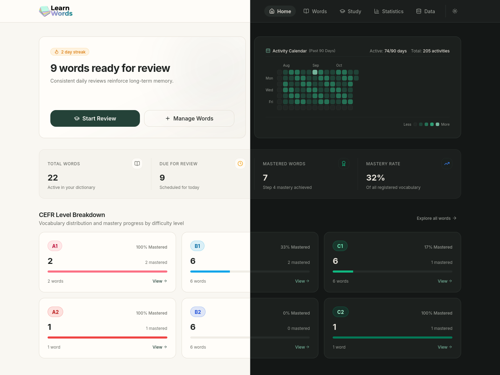
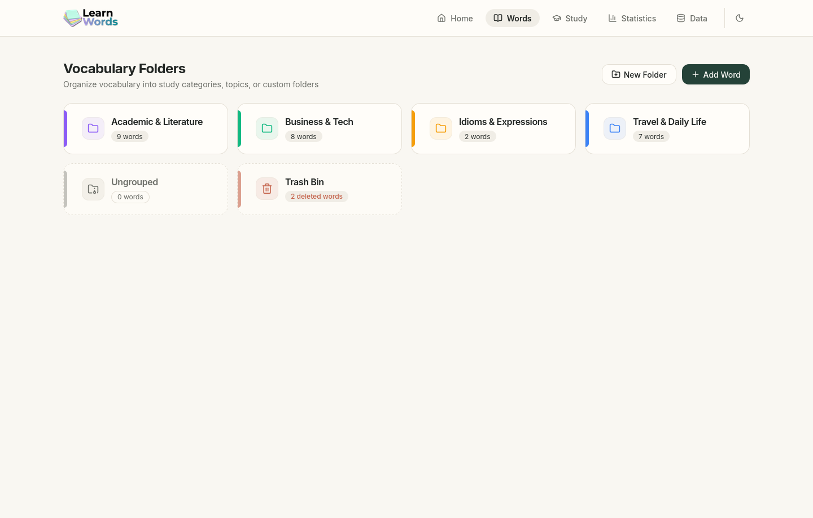
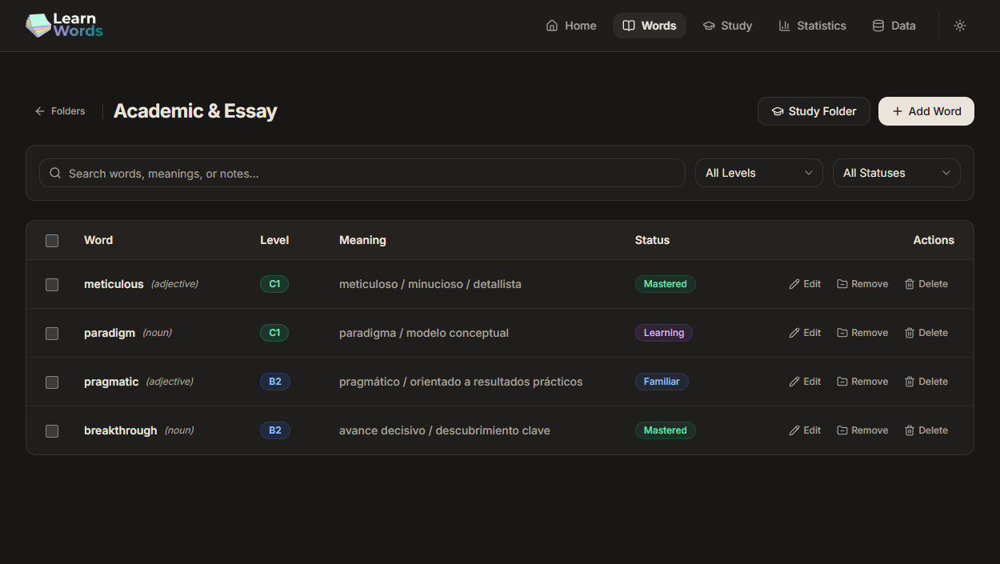
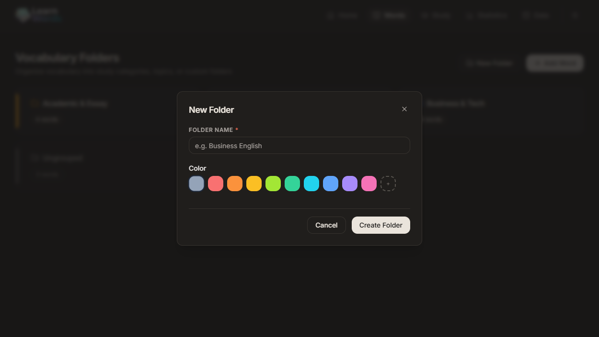
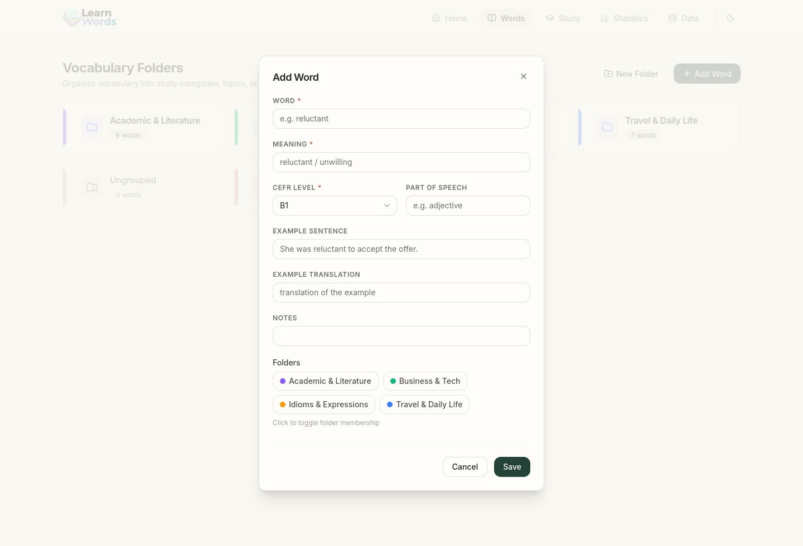
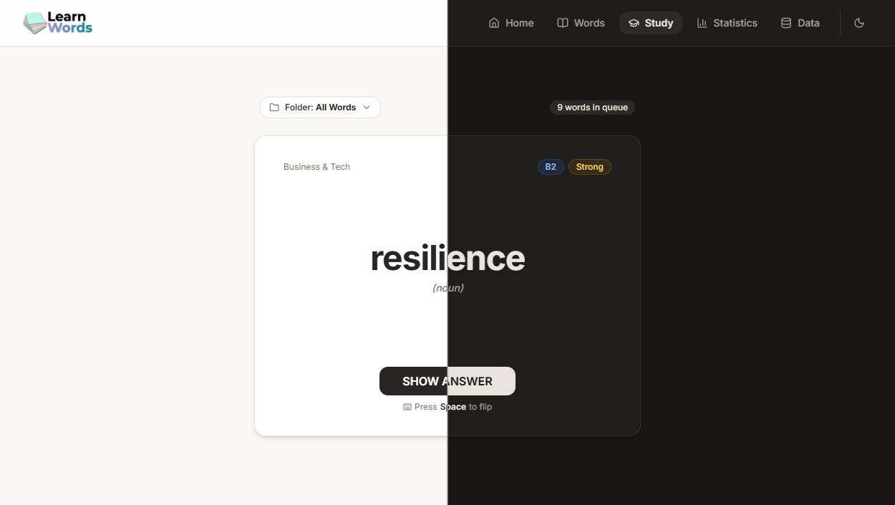
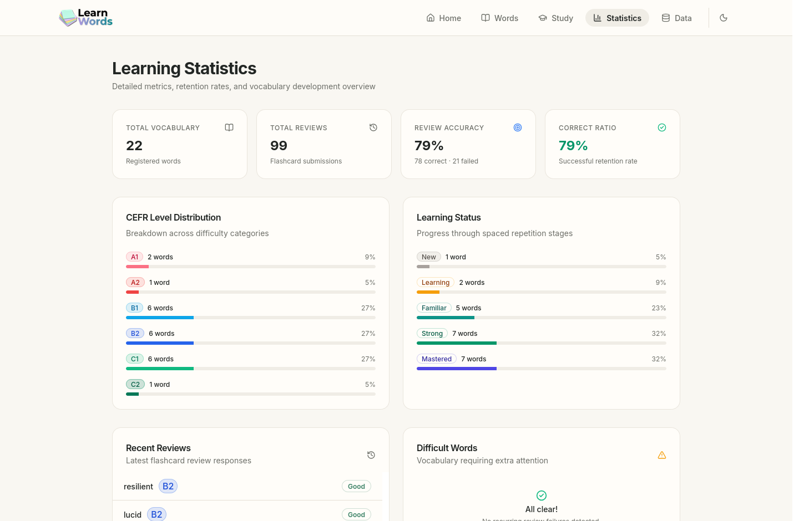
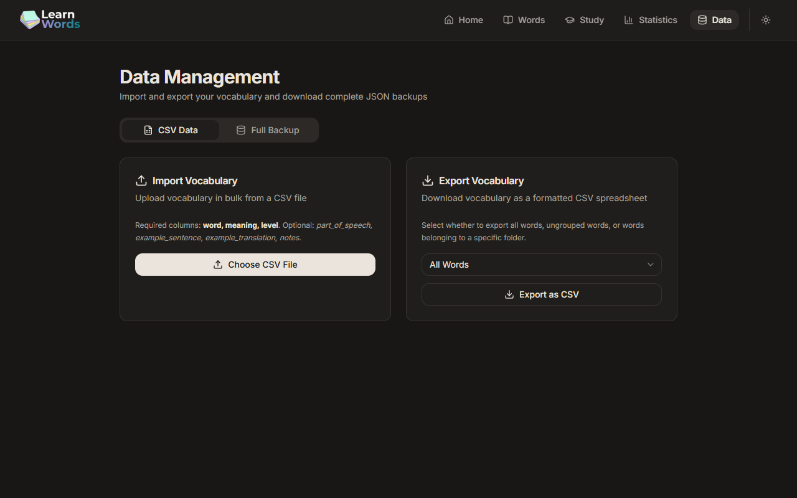

# LearnWords
**This site was created to help users memorize vocabulary using flashcards.**
Additionally, this website was created using AI tools to help me learn to code with artificial intelligence.

*LearnWords supports both light and dark themes.*

---
## **Home**

The Home page features a daily study hub with quick review actions, a 90-day activity calendar to track study consistency, key vocabulary metrics, and a CEFR level breakdown.

---
## **Words**

The Words page lets you organize vocabulary into custom folders and manage words easily.

Folders keep related vocabulary together. You can filter words by CEFR level or learning status, search across your library, and use batch actions to move, update levels, or delete multiple words at once.

Inside each folder, you can view all saved words in a clean table with their CEFR level, meaning, and mastery status.

### **Word Trash Bin & Safe Restoration**

When words are deleted, they are safely moved to the **Trash Bin** card in the folder grid instead of being permanently erased.

- **Safe Restoration:** Restore words individually or in bulk. Spaced repetition progress, mastery level, and review logs are 100% preserved.
- **Permanent Purge:** Selectively delete words forever or use "Empty Trash" with confirmation when you want to permanently clear clutter.
- **Search & Filter:** Search across deleted words and filter by CEFR level directly within the trash view.

---
## **Creating Folders & Adding Words**

You can create custom folders with distinct colors to categorize your vocabulary by topic or learning goal.

In the word addition module, you can specify the target word, its meaning, CEFR level, part of speech, an example sentence, translation, notes, and assign it to multiple folders.

---
## **Study**

On the Study page, interactive flashcards display the target word on the front and its definition, example sentences, and notes on the back.

Powered by a Spaced Repetition System (SRS), the app automatically schedules reviews based on your ratings (Again, Hard, Good, Easy) to build long-term retention. You can also filter your study session by specific folders and use keyboard shortcuts for effortless practice.

### **Sentence Translation Practice**

In addition to traditional word flashcards, LearnWords features context-based sentence translation practice:

- **Bidirectional Practice:** Toggle freely between `Sentence → Translation` and `Translation → Sentence` modes.
- **Active Recall & Typing:** Type your translation in an auto-focused input box to test active retrieval before checking answers.
- **Side-by-Side Comparison:** Compare your typed answer with the canonical reference sentence and target word details.
- **Spaced Repetition Integration:** Grade your recall with standard SRS buttons (`Again`, `Hard`, `Good`, `Easy`) or keyboard shortcuts `1-4`, keeping spaced repetition progress unified across both study modes.

---
## **Statistics**

The Statistics page provides insights into your learning progress, including review accuracy, total reviews, CEFR difficulty distribution, and spaced repetition mastery stages.

---
## **Data Management**

On the Data Management page, you can import vocabulary in bulk from CSV spreadsheets, export word lists, and create or restore full JSON backups anytime.

---
## **Tech Stack**

- **Frontend:** React 18, TypeScript, Vite, Tailwind CSS, shadcn/ui, Lucide Icons
- **Backend:** Node.js, Express
- **Database:** SQLite (`better-sqlite3`)
- **Testing:** Vitest

---
## **Installation**

**Prerequisites**
- [Node.js](https://nodejs.org/) v18 or later

---
**Setup & Run**

Clone repository:
- `git clone https://github.com/bedwen/learnwords`
- `cd learnwords`

Install packages:
- `npm install`

**How To Start Website**

To host the server locally:
- `npm run dev`

Open the application in your browser:
- `http://localhost:5173`
